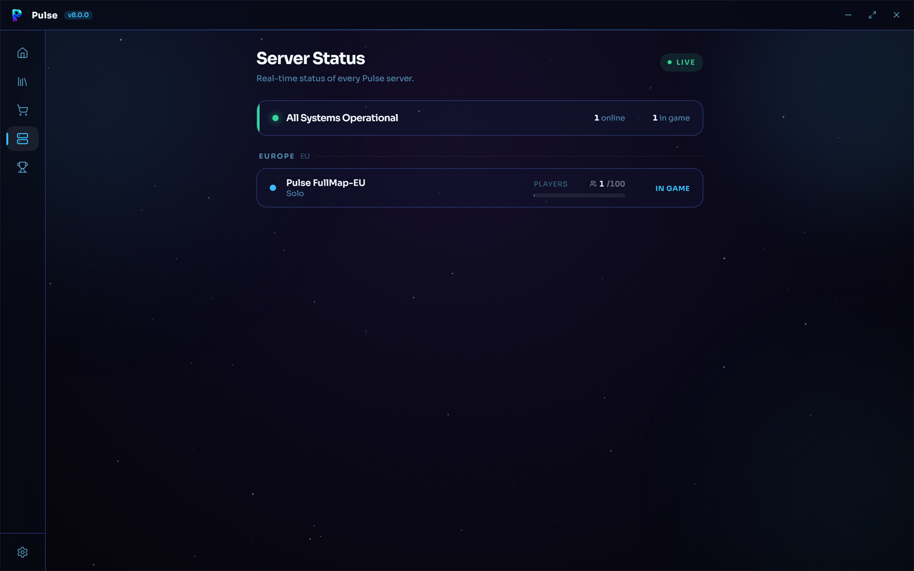
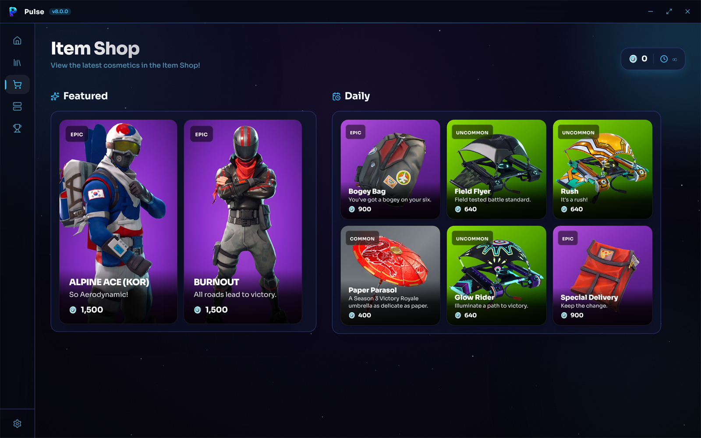
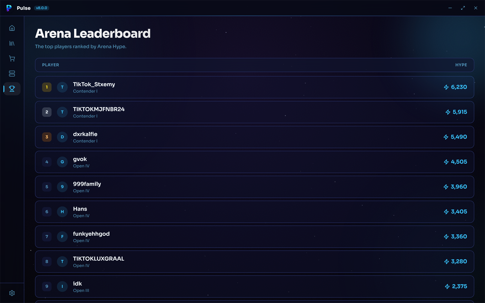
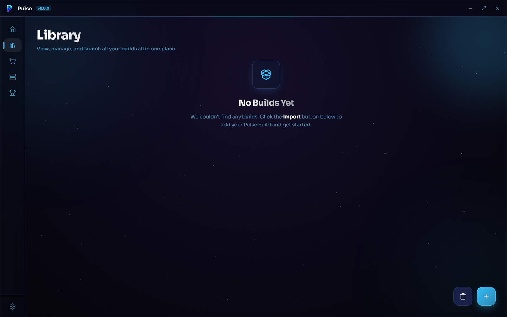
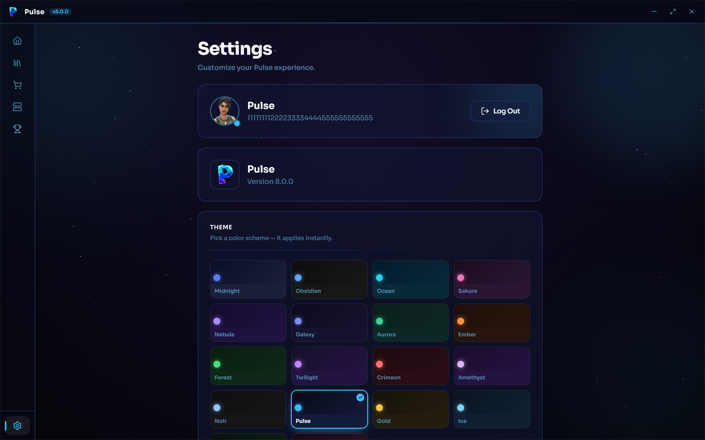
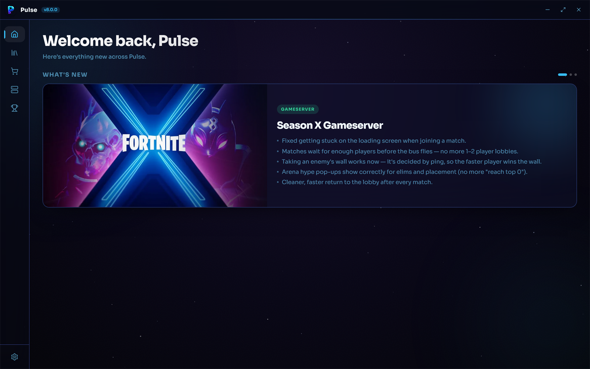

# Pulse Launcher

The official launcher for the **Pulse** Fortnite private server — built with **Tauri (Rust)** + **React + TypeScript**.

This repository is **public for transparency**: anyone can read the code and verify exactly what the launcher does before installing it. Nothing here is hidden, and there are no secrets in this repo.

## What it does
- **Discord login** (OAuth, handled by the Pulse backend)
- **Game files** — downloads and verifies the required paks from the backend, resumable and size-checked
- **Launches Fortnite through the Arc anticheat**
- **Auto-updates itself** (checks the backend for a newer version)
- **Arena Hype leaderboard**, **live server status**, **shop**, and **news**

## Screenshots
Real screenshots of the launcher — every page, so you can see exactly what Pulse looks like.

| Home | Server Status |
| --- | --- |
|  |  |

| Item Shop | Arena Leaderboard |
| --- | --- |
|  |  |

| Library | Settings |
| --- | --- |
|  |  |

| Sign in |
| --- |
|  |

## What is NOT in this repo
The **backend** (accounts, authentication, matchmaking, game APIs, anticheat keys, CDN keys) is closed-source and holds every secret. This repository is the **client only** — it just talks to the Pulse backend, which authenticates every user. A copy of this launcher cannot bypass that.

## Tech
- **Frontend:** React + TypeScript + Tailwind + Vite — [`src/`](src/)
- **Native shell:** Tauri / Rust — [`src-tauri/`](src-tauri/)

## Build
```bash
bun install
bun run tauri build
```
Requires **Bun**, **Rust**, and the Windows build tools. The installer is produced at
`src-tauri/target/release/bundle/msi/`.

To build a **code-signed** release (no "unknown publisher" warning), see
[SIGNING.md](SIGNING.md).

## A note on antivirus / "is this a virus?"
To start the game, the launcher injects a DLL and runs the Arc anticheat — normal
behaviour for a game launcher/anticheat, but some antivirus heuristics flag it anyway.
That's exactly why this source is public: **you can read every line and confirm what it
does.** Official releases are code-signed. Full details in [SECURITY.md](SECURITY.md).

## License
Source-available for transparency and review. See [LICENSE](LICENSE).
